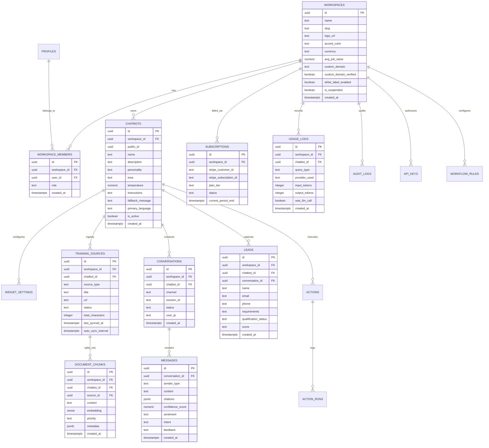
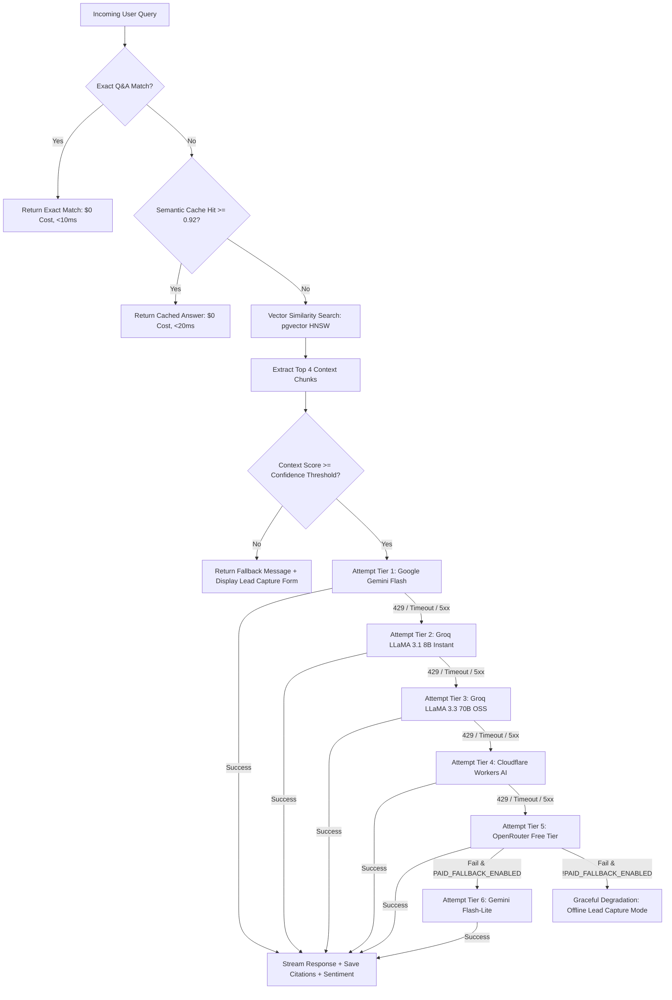

# System Architecture Specification — Chatify AI Chatbot Platform

**Version:** 1.0.0-PROD  
**Status:** Approved Architectural Baseline  

---

## 1. System Overview & Architecture Diagram

```
                              [ End Users / Customers ]
                                /         |         \
                               /          |          \
                 [ Website Widget ]  [ WhatsApp ]  [ Instagram / FB ]
                 (<30KB Vanilla JS)  (Cloud API)   (Messenger API)
                               \          |          /
                                \         |         /
                                 v        v        v
                   ===============================================
                     CHATIFY INGRESS & SECURITY GATEWAY (Next.js)
                     - Domain Whitelist Verification
                     - Upstash Redis Rate Limiting (IP & Workspace)
                     - Zod Input Validation & Sanitization
                   ===============================================
                                          |
                +-------------------------+-------------------------+
                |                                                   |
                v                                                   v
      [ Public Chat API ]                                [ Dashboard API ]
      /api/chat/[public_id]                              /api/workspaces, /api/bots, etc.
                |                                                   |
                v                                                   |
      ==============================                                |
        ANSWERS-BEFORE-AI ENGINE                                    |
        1. Exact Q&A Match (<10ms)                                  |
        2. Upstash Redis Semantic Cache                             |
           (Cosine Sim >= 0.92)                                     |
      ==============================                                |
                |                                                   |
      [ Cache Miss ]                                                |
                |                                                   |
                v                                                   |
      ==============================                                |
        VECTOR RETRIEVAL (RAG)                                      |
        Supabase pgvector (HNSW)                                    |
        Top 4 Chunks + System Prompt                                |
      ==============================                                |
                |                                                   |
                v                                                   |
      ==============================                                |
        CENTRAL AI ROUTER (Failover)                                |
        Tier 1: Google Gemini Flash                                 |
        Tier 2: Groq LLaMA 3.1 8B                                   |
        Tier 3: Groq LLaMA 3.3 70B                                  |
        Tier 4: Cloudflare Workers AI                               |
        Tier 5: OpenRouter Free Models                              |
        Tier 6: Optional Paid Fallback                              |
      ==============================                                |
                |                                                   |
                +-------------------------+-------------------------+
                                          |
                                          v
                   ===============================================
                        SUPABASE CLOUD / POSTGRES STORAGE
                        - Row Level Security (RLS) Enforced
                        - Multi-Tenant Workspaces (workspace_id)
                        - Vector Embeddings (768-dim HNSW)
                        - Storage Buckets (docs, logos, exports)
                   ===============================================
```

---

## 2. Database Entity-Relationship Diagram (ERD)



---

## 3. Comprehensive API Specification

| Endpoint | Method | Auth | Payload / Params | Response | Description |
|---|---|---|---|---|---|
| `/api/chat/[public_id]` | `POST` | Public / Rate-limited | `{ message: string, conversation_id?: string, session_id: string }` | Stream (SSE) / JSON `{ content, citations, confidence, is_lead_triggered }` | Public chat endpoint powering web widget and mobile chat |
| `/api/chat/[public_id]/feedback` | `POST` | Public | `{ message_id: string, feedback: 'up'\|'down', note?: string }` | `{ ok: true }` | Records end-user thumbs-up/down feedback |
| `/api/chat/[public_id]/voice` | `POST` | Public | FormData (audio blob) | `{ text: string }` | Server fallback audio transcription (Groq Whisper) |
| `/api/chat/[public_id]/lead` | `POST` | Public | `{ name, email, phone, requirements, conversation_id }` | `{ ok: true, lead_id: string }` | Widget inline lead submission |
| `/api/workspaces` | `GET` | Session (JWT) | None | `{ workspaces: Workspace[] }` | List workspaces user belongs to |
| `/api/workspaces` | `POST` | Session (JWT) | `{ name: string, accent_color?: string }` | `{ workspace: Workspace }` | Creates a new tenant workspace |
| `/api/workspaces/[id]/settings` | `PATCH` | Owner / Admin | `{ name, logo_url, accent_color, avg_job_value, custom_domain }` | `{ workspace: Workspace }` | Updates branding and configuration |
| `/api/bots` | `GET` | Member | `?workspace_id=uuid` | `{ bots: Chatbot[] }` | Fetch chatbots in workspace |
| `/api/bots` | `POST` | Owner / Admin | `{ name, personality, tone, instructions, appearance }` | `{ bot: Chatbot }` | Creates a new chatbot |
| `/api/bots/[id]` | `PATCH` | Owner / Admin | Bot fields update | `{ bot: Chatbot }` | Updates bot configuration |
| `/api/bots/[id]/duplicate` | `POST` | Owner / Admin | None | `{ bot: Chatbot }` | Clones a bot with its widget configuration |
| `/api/training/crawl` | `POST` | Owner / Admin | `{ chatbot_id, url: string, max_pages?: number }` | `{ source_id, pages_queued: number }` | Ingests website with sitemap crawler |
| `/api/training/text` | `POST` | Owner / Admin | `{ chatbot_id, title: string, content: string }` | `{ source_id, chunks_created: number }` | Ingests raw text or policies |
| `/api/training/qa` | `POST` | Owner / Admin | `{ chatbot_id, pairs: [{question, answer}] }` | `{ count: number }` | Bulk imports high-priority Q&A pairs |
| `/api/training/upload` | `POST` | Owner / Admin | FormData (file: PDF/DOCX/TXT/CSV) | `{ source_id, filename: string }` | Parses file and ingests chunks |
| `/api/training/social` | `POST` | Owner / Admin | `{ chatbot_id, platform: 'fb'\|'ig', url: string }` | `{ source_id, extracted: boolean }` | Ingests social page text |
| `/api/training/youtube` | `POST` | Owner / Admin | `{ chatbot_id, video_url: string }` | `{ source_id, title: string }` | Extracts YouTube captions & ingests |
| `/api/inbox/conversations` | `GET` | Member | `?status=open&channel=all&search=...` | `{ conversations: Conversation[] }` | Unified inbox conversation list |
| `/api/inbox/takeover` | `POST` | Agent / Admin | `{ conversation_id: string, action: 'take'\|'release' }` | `{ ok: true, status: string }` | Toggles human agent takeover |
| `/api/leads` | `GET` | Member | `?workspace_id=uuid` | `{ leads: Lead[] }` | Fetches captured leads with scoring |
| `/api/billing/checkout` | `POST` | Owner | `{ plan: 'starter'\|'pro'\|'agency', cycle: 'monthly' }` | `{ checkout_url: string }` | Initiates Stripe Checkout session |
| `/api/billing/portal` | `POST` | Owner | None | `{ portal_url: string }` | Opens Stripe Customer Portal |
| `/api/billing/webhook` | `POST` | Stripe Signature | Raw Stripe Event | `{ received: true }` | Processes Stripe subscription events |
| `/api/channels/meta/webhook` | `GET` | Meta Challenge | `hub.verify_token`, `hub.challenge` | Raw Challenge String | Webhook handshake for WhatsApp/Messenger/IG |
| `/api/channels/meta/webhook` | `POST` | Meta Signature | Meta Inbound Message Payload | `{ status: 'ok' }` | Ingests WhatsApp/FB/IG messages into chat router |
| `/api/admin/metrics` | `GET` | Super Admin | None | Global MRR, active bots, provider health | Platform-wide monitoring |

---

## 4. AI Router & Failover Flow Diagram



---

## 5. Threat Model & Multi-Tenant Security Isolation

### 1. Row Level Security (RLS) Isolation
Every table within Postgres enforces Row Level Security.
- Direct table selects require that the authenticated Supabase user (`auth.uid()`) has an active membership record in `workspace_members` matching the queried row's `workspace_id`.
- Tenant cross-leakage is blocked at the database engine level, rendering accidental SQL query omissions completely inert.

### 2. Widget Domain Whitelisting & Origin Guard
- Every chatbot possesses an optional `allowed_domains` array (e.g. `['mysalon.com', 'booking.mysalon.com']`).
- When a web browser requests `/api/chat/[public_id]`, the server validates the HTTP `Origin` and `Referer` headers against the whitelist.
- If an origin does not match, the API rejects the request with HTTP 403, preventing competitors or bad actors from leeching a business's AI chatbot.

### 3. Rate Limiting & Abuse Prevention
- Rate limits are enforced on all public and authenticated endpoints via Upstash Redis sliding window token buckets:
  - Public Chat: 30 requests / minute per IP; 120 requests / minute per Bot.
  - Ingest & Crawl: 5 crawl jobs / hour per Workspace.
  - Lead Submission: 5 submissions / minute per IP.

### 4. Injection & Safe Markdown Rendering
- Prompt Injection Defense: System prompt incorporates boundary tags (`<context>` ... `</context>`) and explicit instruction fences forbidding user instructions from overriding system persona or business knowledge.
- Client-Side XSS Protection: The chat UI renders bot markdown responses using sanitized HTML parsers stripping `<script>`, `<iframe>`, `onload`, and javascript-href vectors.
